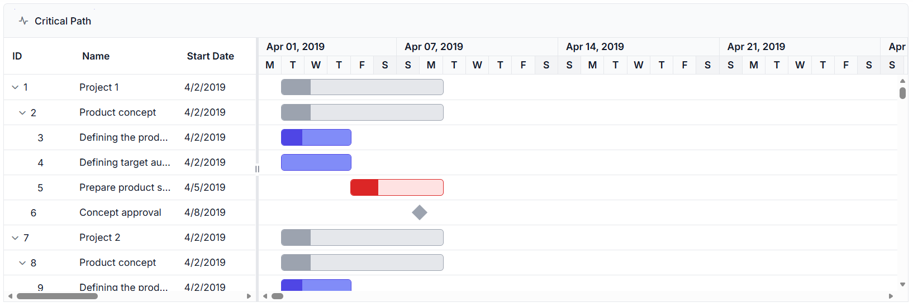
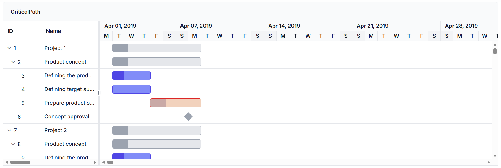

# Critical Path Identification in ASP.NET Core Gantt Chart

The critical path represents the longest sequence of dependent tasks that determines the minimum project duration. Tasks on the critical path have zero or negative slack (float), meaning any delay in these tasks directly impacts the overall project completion date. The [ASP.NET Core Gantt Chart](https://www.syncfusion.com/aspnet-core-ui-controls/gantt-chart) component automatically calculates and highlights critical tasks in red with emphasized dependency connector lines when the [enableCriticalPath](https://help.syncfusion.com/cr/aspnetcore-js2/Syncfusion.EJ2.Gantt.Gantt.html#Syncfusion_EJ2_Gantt_Gantt_EnableCriticalPath) property is enabled. Critical path analysis helps identify which tasks require immediate attention and cannot be delayed without affecting project deadlines.

## Understanding critical path calculation

The component uses Critical Path Method (CPM) principles to identify critical tasks through a comprehensive calculation process that analyzes task dependencies, timing relationships, and slack values to determine which tasks have no scheduling flexibility. A task becomes critical when it has zero or negative slack, meaning any delay (even by a minute) shifts the entire project end date. This occurs because critical tasks are linked through dependencies, creating a chain reaction where delays propagate across the dependency network, ultimately affecting the project completion date.

**Project end date determination**: The calculation begins by determining the overall project end date. If the [projectEndDate](https://help.syncfusion.com/cr/aspnetcore-js2/Syncfusion.EJ2.Gantt.Gantt.html#Syncfusion_EJ2_Gantt_Gantt_ProjectEndDate) property is provided, it uses that value as the project completion reference. If `projectEndDate` is not specified, the component automatically calculates the project end date by examining all task end dates in the data source to find the latest completion point. This reference point determines how much delay each task can tolerate without affecting project completion.

**Slack value calculation**: For each task, the component calculates slack by measuring the time difference between the task's end date and the project end date. Slack represents how much time a task can be delayed without affecting the project completion:

- **Zero slack**: The task must finish exactly on time. Any delay will push back the project end date, making it critical
- **Negative slack**: The task is already behind schedule or creates scheduling conflicts. This occurs when a task's end date is beyond the project end date, or when dependency relationships create impossible timing constraints.

**Parent-Child task relationships**: In projects with hierarchical tasks, the critical path calculation focuses on dependencies rather than the parent-child structure used for task organization. For example, if Task 1.1 (a child task) depends on Task 2 (a parent task), only the tasks directly linked by the dependency are evaluated for criticality based on their timing. A parent task like Task 2 being critical does not automatically make its child tasks (e.g., Task 2.1, Task 2.2) critical, nor does a critical child task imply a critical parent. The component evaluates each task’s slack independently, ensuring that only tasks with zero or negative slack, driven by their dependency constraints, are marked as critical. This distinction allows precise identification of critical tasks without conflating organizational hierarchy with scheduling dependencies.

**Dependency-based analysis**: The component analyzes different dependency relationship types to determine slack impacts:

- **Finish-to-Start**: When a predecessor task ends after its successor should start, negative slack results from the timing conflict
- **Start-to-Start**: When a predecessor starts after its successor should start, the component calculates negative slack based on scheduling impossibility
- **Finish-to-Finish** and **Start-to-Finish**: These relationships can also produce negative slack when timing conflicts exist between connected tasks
- **Offset and scheduling mode handling**: When dependencies include time offsets (e.g., "+2 days" or "-1 hour"), the component adjusts slack calculations by factoring in the offset duration. The calculation differs for automatically scheduled versus manually scheduled tasks: automatic tasks use forward and backward pass algorithms to compute slack, while manual tasks compare their end dates directly against the project completion date.

**Progress consideration**: The component considers task completion progress. Only tasks with less than 100% progress can be marked as critical, since completed tasks cannot cause future delays. Tasks that end on or beyond the project end date automatically become critical regardless of their dependency relationships, as they directly determine the project completion timing.

## Critical path setup and configuration

Critical path functionality requires tasks with valid start dates, end dates, and dependencies mapped through the `dependency` field in `taskFields`.
Enable critical path display by setting [enableCriticalPath](https://help.syncfusion.com/cr/aspnetcore-js2/Syncfusion.EJ2.Gantt.Gantt.html#Syncfusion_EJ2_Gantt_Gantt_EnableCriticalPath) to **true**, or add the `CriticalPath` option to the [toolbar](https://help.syncfusion.com/cr/aspnetcore-js2/Syncfusion.EJ2.Gantt.Gantt.html#Syncfusion_EJ2_Gantt_Gantt_Toolbar) array to allow interactive toggling. The `getCriticalTasks()` method retrieves all tasks identified as critical at runtime.

The critical path recalculates automatically when task properties change, including start and end dates, duration modifications, dependency updates, or progress adjustments. This ensures the visualization remains accurate throughout project management workflows.

The following example demonstrates enabling critical path analysis:










The code enables critical path analysis by setting `enableCriticalPath` to **true**. The component automatically calculates slack values for all tasks and highlights those with zero or negative slack as critical tasks, displaying them with red taskbars and emphasized dependency lines.

## Customizing critical path appearance

The [queryTaskbarInfo](https://help.syncfusion.com/cr/aspnetcore-js2/Syncfusion.EJ2.Gantt.Gantt.html#Syncfusion_EJ2_Gantt_Gantt_QueryTaskbarInfo) event provides access to the `isCritical` property for each task, enabling custom styling beyond the default red highlighting. Modify the `taskbarBgColor`, `progressBarBgColor`, or other visual properties to create distinct visual indicators for critical tasks.

The following example demonstrates custom styling for critical tasks using the `queryTaskbarInfo` event:










The event handler checks the `isCritical` flag and applies custom colors to taskbars, allowing project-specific visual distinctions for critical path tasks while maintaining clear identification of project bottlenecks.

## See also

- [How to configure task dependencies?](https://ej2.syncfusion.com/aspnetcore/documentation/gantt/task-dependency)
- [How to enable virtual scrolling?](https://ej2.syncfusion.com/aspnetcore/documentation/gantt/scrolling/virtual-scrolling)
- [How to customize taskbars?](https://ej2.syncfusion.com/aspnetcore/documentation/gantt/taskbar)
