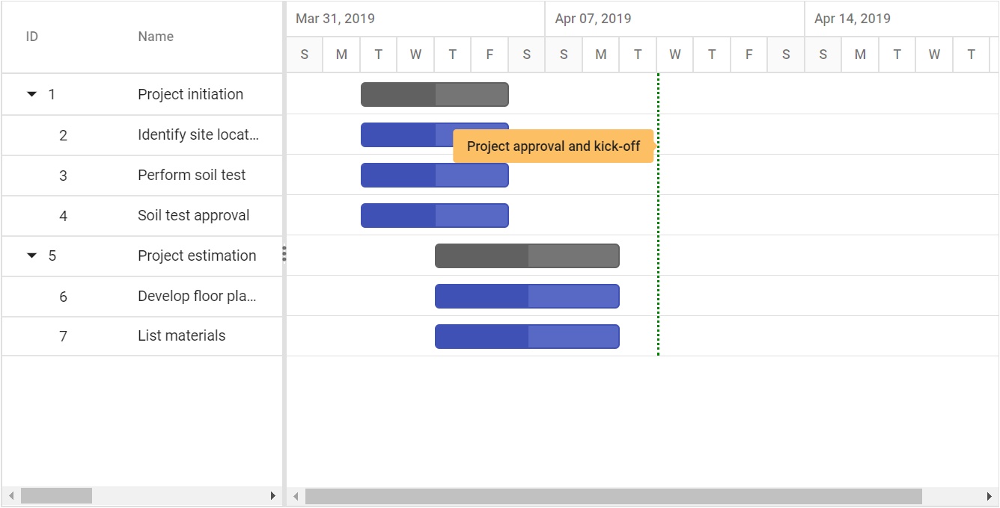

# Project-Wide Timeline Markers in ASP.NET Core Gantt Chart

Event markers highlight significant project events by displaying vertical timeline indicators that span across the entire Gantt chart. These markers identify critical dates, milestones, deadlines, or important project events that affect multiple tasks or the overall project timeline, providing visual reference points for project-wide activities.

Understanding event markers implementation enables effective visualization of project-critical dates and enhances timeline awareness across all project phases.

Event markers utilize specific properties to define their positioning, appearance, and identification within the project timeline:

**Date positioning**: The [`Day`](https://help.syncfusion.com/cr/aspnetcore-js2/Syncfusion.EJ2.Gantt.GanttEventMarker.html#Syncfusion_EJ2_Gantt_GanttEventMarker_Day) property establishes the exact timeline date where the marker appears. This date value determines marker placement across the entire vertical timeline, ensuring accurate project event representation.

**Descriptive labeling**: The [`Label`](https://help.syncfusion.com/cr/aspnetcore-js2/Syncfusion.EJ2.Gantt.GanttEventMarker.html#Syncfusion_EJ2_Gantt_GanttEventMarker_Label) property provides descriptive text that identifies the marker's purpose or significance. Labels enhance user understanding by clearly indicating what project event the marker represents.

**Visual customization**: The [`CssClass`](https://help.syncfusion.com/cr/aspnetcore-js2/Syncfusion.EJ2.Gantt.GanttEventMarker.html#Syncfusion_EJ2_Gantt_GanttEventMarker_CssClass) property enables custom styling through CSS class applications. This property allows distinctive visual treatment for different marker types, supporting color coding, styling variations, and brand consistency.

**Vertical adjustment**: The [`Top`](https://help.syncfusion.com/cr/aspnetcore-js2/Syncfusion.EJ2.Gantt.GanttEventMarker.html#Syncfusion_EJ2_Gantt_GanttEventMarker_Top) property specifies the vertical offset (in pixels) of the marker from the top of the chart pane's content area. This property helps prevent visual overlap when multiple markers share the same date, ensuring clear and organized marker placement.

## Event marker configuration

Event markers render as vertical lines positioned at specific dates across the entire Gantt timeline, distinguishing them from data markers which appear within individual task rows. This project-wide visibility ensures critical dates remain prominent regardless of the current view or task focus.

**Timeline integration**: Event markers integrate seamlessly with the Gantt timeline, appearing as vertical indicators that extend from the top to the bottom of the chart area. This comprehensive visibility ensures important dates remain visible during scrolling, zooming, or filtering operations.

**Configuration requirements**: Event markers can be initialized using the [`EventMarkers`](https://help.syncfusion.com/cr/aspnetcore-js2/Syncfusion.EJ2.Gantt.Gantt.html#Syncfusion_EJ2_Gantt_Gantt_EventMarkers) property of the Gantt control to enable rendering functionality. This property manages marker positioning, styling, and timeline integration logic.

**Multiple marker support**: The control supports multiple event markers simultaneously, allowing comprehensive tracking of various project-critical dates within the same timeline view. Each marker maintains independent configuration while sharing the common timeline space.

The following implementation demonstrates event marker integration within a Gantt chart, showcasing timeline-wide event highlighting:










## Programmatically show and hide event markers

You can programmatically show or hide event markers in the Gantt Chart by updating the [`EventMarkers`](https://help.syncfusion.com/cr/aspnetcore-js2/Syncfusion.EJ2.Gantt.Gantt.html#Syncfusion_EJ2_Gantt_Gantt_EventMarkers) property from script using the Gantt instance.










## See also

- [How to bind data to the Gantt chart?](https://help.syncfusion.com/gantt-sdk/asp-net-core/gantt-chart/data-binding)
- [How to enable context menu in Gantt chart?](https://help.syncfusion.com/gantt-sdk/asp-net-core/gantt-chart/context-menu)
- [How to compare planned vs. actual schedules?](https://help.syncfusion.com/gantt-sdk/asp-net-core/gantt-chart/baseline)
- [How to visualize critical tasks in Gantt chart?](https://help.syncfusion.com/gantt-sdk/asp-net-core/gantt-chart/criticalpath)
- [How to highlight task-specific events?](https://help.syncfusion.com/gantt-sdk/asp-net-core/gantt-chart/data-markers)