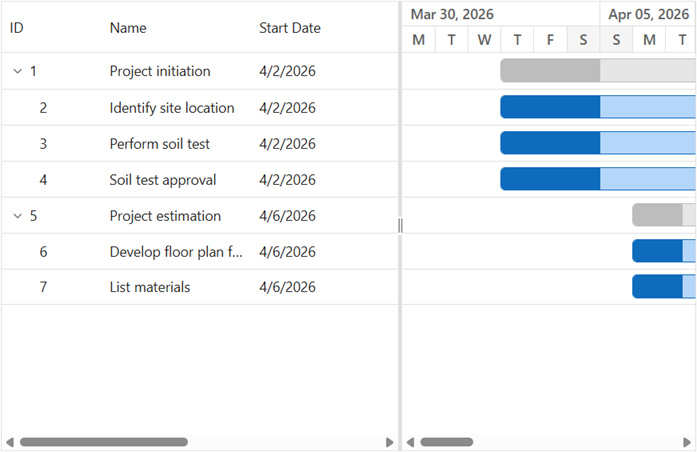

# Getting Started with ASP.NET Core Gantt Chart

The [ASP.NET Core Gantt Chart](https://www.syncfusion.com/gantt-sdk/aspnet-core-gantt-chart) is a UI control designed to visualize and manage project schedules using a timeline view. It supports hierarchical task structures, automatic scheduling, and rich interactive features.

This guide demonstrates how to create an ASP.NET Core application, configure task data, and render a basic Gantt Chart.

## Prerequisites

Ensure the following prerequisites are installed:

- [Visual Studio 2022](https://visualstudio.microsoft.com/downloads/) or [Visual Studio Code](https://code.visualstudio.com) with the [.NET SDK](https://dotnet.microsoft.com/download) (.NET 8 or later recommended)
- Basic knowledge of ASP.NET Core Razor Pages
- A valid Syncfusion&reg; license key for commercial use. You can obtain a key from your [Syncfusion account](https://www.syncfusion.com/account) and register it as shown in the [licensing documentation](https://ej2.syncfusion.com/aspnetcore/documentation/licensing/license-key-registration).

## Create an ASP.NET Core Web App with Razor Pages

You can create an ASP.NET Core Web App using Visual Studio via [Microsoft Templates](https://learn.microsoft.com/en-us/aspnet/core/tutorials/razor-pages/razor-pages-start?view=aspnetcore-10.0&tabs=visual-studio#create-a-razor-pages-web-app) or the [ASP.NET Core Extension](https://ej2.syncfusion.com/aspnetcore/documentation/visual-studio-integration/create-project).

Alternatively, using the terminal:




dotnet new webapp -o SyncfusionGanttApp
cd SyncfusionGanttApp




## Install the required NuGet packages

Install the [Syncfusion.AspNetCore.Gantt](https://www.nuget.org/packages/Syncfusion.AspNetCore.Gantt) and [Syncfusion.AspNetCore.Themes](https://www.nuget.org/packages/Syncfusion.AspNetCore.Themes) NuGet packages. All Syncfusion ASP.NET Core packages are available on [nuget.org](https://www.nuget.org/packages?q=Syncfusion.EJ2). See the [NuGet packages](https://ej2.syncfusion.com/aspnetcore/documentation/nuget-packages) topic for details.




dotnet add package Syncfusion.AspNetCore.Gantt
dotnet add package Syncfusion.AspNetCore.Themes




## Add ASP.NET Core tag helpers

After the packages are installed, open the **~/Pages/\_ViewImports.cshtml** file and import the `Syncfusion.AspNetCore.Gantt` and `Syncfusion.AspNetCore.Base` tag helpers.




@addTagHelper *, Syncfusion.AspNetCore.Gantt
@addTagHelper *, Syncfusion.AspNetCore.Base




## Add stylesheet and script resources

The theme stylesheet and script can be referenced from NuGet through [Static Web Assets](https://ej2.syncfusion.com/aspnetcore/documentation/appearance/theme#static-web-assets). Include the stylesheet and script references inside the `<head>` of **~/Pages/Shared/\_Layout.cshtml** file.




<head>
    ...
    <link rel="stylesheet" href="_content/Syncfusion.AspNetCore.Themes/styles/fluent2.css" />
    
</head>




## Register the script manager

Open the **~/Pages/Shared/\_Layout.cshtml** file and register the script manager (`<ejs-scripts>`) at the end of the `<body>` element as shown below.




<body>
    ...
    <!-- Syncfusion ASP.NET Core Script Manager -->
    <ejs-scripts></ejs-scripts>
</body>




## Create sample task data

Define a simple task list with hierarchical relationships. The data includes two parent tasks (TaskId 1 and 5) with child tasks linked via `ParentID`. Each task must have a `StartDate` and either a `Duration` (in days) or an `EndDate` to render properly. All datasource records are defined in the **~/Pages/Index.cshtml.cs** page model.




using Microsoft.AspNetCore.Mvc.RazorPages;

public class IndexModel : PageModel
{
    public List<GanttDataSource> Tasks = new List<GanttDataSource>()
    {
        new GanttDataSource() { TaskId = 1, TaskName = "Project initiation", StartDate = new DateTime(2024, 04, 01), EndDate = new DateTime(2024, 04, 15) },
        new GanttDataSource() { TaskId = 2, TaskName = "Identify site location", StartDate = new DateTime(2024, 04, 01), Duration = 4, ParentId = 1 },
        new GanttDataSource() { TaskId = 3, TaskName = "Perform site survey", StartDate = new DateTime(2024, 04, 01), Duration = 4, ParentId = 1 },
        new GanttDataSource() { TaskId = 4, TaskName = "Soil testing", StartDate = new DateTime(2024, 04, 01), Duration = 3, ParentId = 1 },
        new GanttDataSource() { TaskId = 5, TaskName = "Project estimation", StartDate = new DateTime(2024, 04, 15), EndDate = new DateTime(2024, 04, 25) },
        new GanttDataSource() { TaskId = 6, TaskName = "Develop floor plan", StartDate = new DateTime(2024, 04, 15), Duration = 5, ParentId = 5 },
        new GanttDataSource() { TaskId = 7, TaskName = "Estimate project cost", StartDate = new DateTime(2024, 04, 15), Duration = 5, ParentId = 5 }
    };

    public void OnGet()
    {
    }
}

public class GanttDataSource
{
    public int TaskId { get; set; }
    public string TaskName { get; set; }
    public DateTime StartDate { get; set; }
    public DateTime? EndDate { get; set; }
    public int? Duration { get; set; }
    public int? Progress { get; set; }
    public int? ParentId { get; set; }
}




## Configure task fields mapping

Map the data fields to Gantt Chart properties using the `<e-gantt-taskfields>` tag helper in **~/Pages/Index.cshtml**:




<e-gantt-taskfields id="TaskId" name="TaskName" startDate="StartDate" endDate="EndDate" duration="Duration" progress="Progress" parentId="ParentId">
</e-gantt-taskfields>




### Field mapping reference

| Property | Description | Required |
|----------|-------------|----------|
| `id`     | Unique task identifier | Yes |
| `name`   | Task display name | Yes |
| `startDate` | Task start date | Yes |
| `duration` | Task duration in days | Either Duration or EndDate |
| `endDate` | Task end date | Either Duration or EndDate |
| `parentId` | Parent task ID for hierarchy | No |

## Render the ASP.NET Core Gantt Chart control

Add the Gantt control in the **~/Pages/Index.cshtml** file and bind the task collection using the `dataSource` property.




@page
@model IndexModel

<ejs-gantt id="Gantt" height="450px" dataSource="@Model.Tasks">
    <e-gantt-taskfields id="TaskId" name="TaskName" startDate="StartDate" endDate="EndDate" duration="Duration" parentId="ParentId">
    </e-gantt-taskfields>
</ejs-gantt>




**Key Properties**:
- `@page` — Denotes a Razor Pages endpoint that can handle requests without a controller
- `@model IndexModel` — Binds the page to the `IndexModel` page model containing the task data
- `dataSource` — Binds the task data collection to the Gantt Chart
- `taskFields` — Maps the data source field names to Gantt task properties

## Run the application

Start the application with:




dotnet run




This command:
- Builds and launches the ASP.NET Core application
- Hosts the application on `https://localhost:<port>` (the port is shown in the console output)
- Serves the Gantt Chart from the **Index** page

**Troubleshooting**:
- **Build errors**: Ensure the .NET SDK version installed matches the target framework in the project file
- **Missing packages**: Restore dependencies with `dotnet restore`
- **Styles not applied**: Verify the stylesheet references in **~/Pages/Shared/\_Layout.cshtml** are correct
- **Blank chart**: Ensure the `<ejs-scripts>` tag is registered at the end of the `<body>` and the element `<ejs-gantt>` has a unique `id`

## Output

The Gantt Chart displays:

- Task hierarchy with parent-child relationships
- Timeline view showing task bars
- Automatically calculated dates based on duration

The chart displays two parent tasks (Project initiation, Project estimation) with child tasks shown in a tree structure. Task bars are rendered on the timeline, sized according to their duration and start dates.

## Error handling

Proper error handling helps identify and resolve issues during development. The Gantt Chart provides events to capture validation and configuration errors.

### Common error scenarios

- **Missing taskFields mapping** — If `taskFields` is not properly configured, the Gantt Chart cannot map data fields to task properties. Ensure all required fields (`id`, `name`, `startDate`) are mapped.
- **Invalid date format** — Task dates must be valid `DateTime` values. Invalid dates prevent proper rendering.
- **Missing dataSource** — Ensure `dataSource` is bound to the control with task data.
- **Unsupported field types** — The `id` field must be numeric or string; Duration must be numeric.
- **Tag helpers not registered** — Verify that the `@addTagHelper` directives are added in **\_ViewImports.cshtml**.

### Handling errors with actionFailure event

Use the `actionFailure` event to capture and handle errors:




@page
@model IndexModel

<ejs-gantt id="Gantt" height="450px" dataSource="@Model.Tasks" actionFailure="actionFailure">
    <e-gantt-taskfields id="TaskId" name="TaskName" startDate="StartDate" endDate="EndDate" duration="Duration" parentId="ParentId">
    </e-gantt-taskfields>
</ejs-gantt>




## Next Steps

- **[Key Elements](https://help.syncfusion.com/gantt-sdk/asp-net-core/gantt-chart/key-elements)** - Learn about UI components and interactions
- **[Overview](https://help.syncfusion.com/gantt-sdk/asp-net-core/gantt-chart/overview)** - Explore all available features

N> Looking for the full ASP.NET Core Gantt Chart control overview, features, pricing, and documentation? Visit the [ASP.NET Core Gantt Chart](https://www.syncfusion.com/gantt-sdk/aspnet-core-gantt-chart) page.