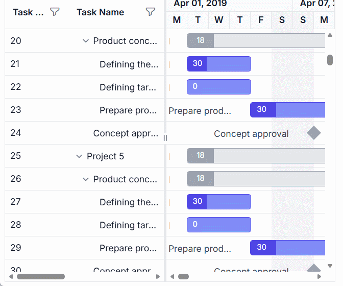

# Loading Animation in ASP.NET Core Gantt Chart 

The [ASP.NET Core Gantt Chart](https://www.syncfusion.com/aspnet-core-ui-controls/gantt-chart) component displays loading indicators to provide visual feedback during data processing operations like sorting, filtering, scrolling, or data binding, enhancing user experience by signaling active processes. Configured via the [loadingIndicator.indicatorType](https://help.syncfusion.com/cr/aspnetcore-js2/Syncfusion.EJ2.Gantt.GanttLoadingIndicator.html#Syncfusion_EJ2_Gantt_GanttLoadingIndicator_IndicatorType) property, indicators support two types: **Spinner**, a rotating circular animation for quick operations, and **Shimmer**, an animated placeholder for data-intensive tasks like virtual scrolling with large datasets. Indicators appear automatically during initial data binding, data updates, filtering, sorting, scrolling, and expand/collapse actions, ensuring users perceive system activity. The Spinner is lightweight and ideal for simple updates, while Shimmer previews content layout for complex operations but may be resource-intensive for small datasets. Indicators support accessibility with ARIA labels and adapt to responsive designs for consistent visibility.

## Configure loading indicators

Loading indicators are configured using the [loadingIndicator](https://help.syncfusion.com/cr/aspnetcore-js2/Syncfusion.EJ2.Gantt.GanttLoadingIndicator.html) property, with `indicatorType` set to **Spinner** (default) or **Shimmer**. Changes to `indicatorType` require component re-initialization for reflection.

The following example configures a Shimmer indicator:

```cshtml
<ejs-gantt id="Gantt" dataSource="ViewBag.DataSource" height="450px">
    <e-gantt-loadingIndicator indicatorType="Shimmer"></e-gantt-loadingIndicator>
</ejs-gantt>
```

This code sets a Shimmer indicator for operations like virtual scrolling, providing a modern loading experience. Use Spinner for quick operations to minimize resource usage.

The following example shows indicator usage:












## Control loading indicators manually

For custom scenarios, such as asynchronous data processing, manually control indicators using the [showSpinner](https://help.syncfusion.com/cr/aspnetcore-js2/Syncfusion.EJ2.Gantt.Gantt.html#Syncfusion_EJ2_Gantt_Gantt_ShowSpinner) and [hideSpinner](https://help.syncfusion.com/cr/aspnetcore-js2/Syncfusion.EJ2.Gantt.Gantt.html#Syncfusion_EJ2_Gantt_Gantt_HideSpinner) methods. Ensure that the Gantt client instance is available before invoking these methods.

The following example demonstrates manual control:


```cshtml
<button type="button" onclick="showCustomLoading()">Show loading indicator</button>
<ejs-gantt id="Gantt" dataSource="ViewBag.DataSource" height="450px"></ejs-gantt>

<script>
    function showCustomLoading() {
        var gantt = document.getElementById('Gantt').ej2_instances[0];
        gantt.showSpinner();
        window.setTimeout(function () {
            gantt.hideSpinner();
        }, 2000);
    }
</script>
```

This code displays a loading indicator during a simulated 2-second data operation, ensuring clear feedback. Use manual control only for specific business logic to avoid overriding automatic behavior.

## See also
- [How to configure virtual scrolling?](https://ej2.syncfusion.com/aspnetcore/documentation/gantt/scrolling/virtual-scrolling)
- [How to manage data filtering?](https://ej2.syncfusion.com/aspnetcore/documentation/gantt/filtering)
- [How to enable sorting?](https://ej2.syncfusion.com/aspnetcore/documentation/gantt/sorting)