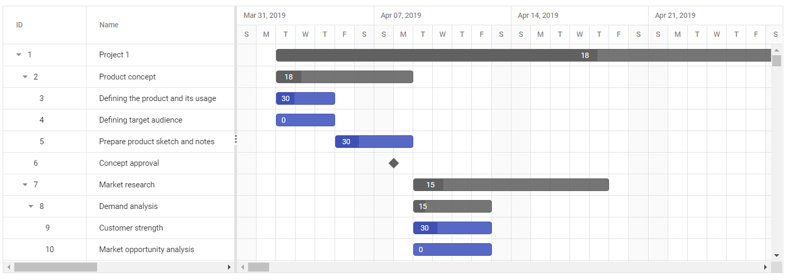

# Optimization with Virtual Scrolling in ASP.NET Core Gantt Chart

This guide provides practical techniques to optimize the [ASP.NET Core Gantt Chart](https://www.syncfusion.com/gantt-sdk/aspnet-core-gantt-chart) control's performance, particularly when working with large datasets. Learn how to implement best practices that maintain smooth user experience while handling substantial amounts of project data efficiently.

## Improving loading performance with large datasets

A Gantt chart renders rows, columns, and taskbars in the DOM. For example, displaying 10 rows and 10 columns creates 100 elements in the grid area DOM and 10 elements in the chart area DOM. To ensure optimal loading performance, limit the number of rendered rows and columns when working with large datasets.

### Optimizing performance with virtualization

Virtualization techniques significantly improve application efficiency when handling large datasets by rendering only visible content:

1. **Row virtualization**: The virtual scrolling feature enables efficient handling of large data volumes by loading only visible rows within the Gantt viewport rather than rendering the entire dataset. This optimization occurs during vertical scroll actions. For detailed implementation, refer to the [row virtualization documentation](https://help.syncfusion.com/gantt-sdk/asp-net-core/gantt-chart/virtual-scrolling#configure-row-virtualization).

2. **Timeline virtualization**: This feature optimizes timeline rendering by loading only visible timeline cells (typically three viewport widths). Additional timeline cells render on-demand during horizontal scrolling. For implementation details, see the [timeline virtualization documentation](https://help.syncfusion.com/gantt-sdk/asp-net-core/gantt-chart/virtual-scrolling#configure-timeline-virtualization).

3. **Load on demand**: This feature renders large task collections with optimal performance. With virtualization enabled, only root-level records load initially. Child tasks load dynamically when expanding parent nodes or scrolling vertically, ensuring only necessary data renders based on the current viewport position.

### Optimizing performance with AutoCalculateDateScheduling

By default, the Gantt Chart control automatically calculates start and end dates in the [`DataSource`](https://help.syncfusion.com/cr/aspnetcore-js2/Syncfusion.EJ2.Gantt.Gantt.html#Syncfusion_EJ2_Gantt_Gantt_DataSource) based on working time, holidays, weekends, and predecessors. For large datasets, these calculations can impact performance.

Set the [`AutoCalculateDateScheduling`](https://help.syncfusion.com/cr/aspnetcore-js2/Syncfusion.EJ2.Gantt.Gantt.html#Syncfusion_EJ2_Gantt_Gantt_AutoCalculateDateScheduling) property to **false** to improve initial load performance. This disables parent-child validation, data validation, and predecessor validation, allowing faster rendering.

**Important**: When disabling `AutoCalculateDateScheduling`, provide complete data including start date, end date, and duration in your data source.












> When setting the `AutoCalculateDateScheduling` property to **false**, you must provide a valid data source; otherwise, the Gantt chart will render with invalid dates.

### Optimizing custom content rendering

When integrating images or template elements into Gantt columns, use the [Column Template](https://help.syncfusion.com/gantt-sdk/asp-net-core/gantt-chart/columns/column-template) feature instead of customizing data through the [`RowDataBound`](https://help.syncfusion.com/cr/aspnetcore-js2/Syncfusion.EJ2.Gantt.Gantt.html#Syncfusion_EJ2_Gantt_Gantt_RowDataBound) or [`QueryCellInfo`](https://help.syncfusion.com/cr/aspnetcore-js2/Syncfusion.EJ2.Gantt.Gantt.html#Syncfusion_EJ2_Gantt_Gantt_QueryCellInfo) events. These events trigger for each row and cell, potentially causing rendering delays and element persistence issues over time.

### Performance benchmarks

The following tables show typical load times for various Gantt configurations, comparing non-virtualized and virtualized scenarios:

**Test environment**

- Component Version: Syncfusion ASP.NET Core Gantt 35.1.27
- .NET Runtime: .NET 8
- Browser: Edge 152
- Operating System: Windows 11
- CPU: 11th Gen Intel® Core™ i5-1135G7 @ 2.40GHz
- RAM: 16GB

**Non-virtualized scenario (2,500 tasks)**

| Scenario                        | Load time (seconds) |
|---------------------------------|---------------------|
| Default hierarchy (Parent-Child) | 4.5                 |
| + Predecessor                   | 6.7                 |
| + Resources                     | 7.5                 |
| + Split taskbars                | 6.8                 |

**Virtualized scenario (25,000 tasks)**

| Scenario                        | Load time (seconds) |
|---------------------------------|---------------------|
| Default hierarchy (Parent-Child) | 3.9                 |
| + Predecessor                   | 5.9                 |
| + Resources                     | 6.5                 |
| + Split taskbars                | 10.6                |

## Avoiding maxJsonLength errors with large datasets

The Gantt Chart control operates on a client-server basis, sending data as JSON objects. Large JSON object serialization can cause MaxJsonLength errors. Resolve this by increasing the maximum length for JSON serialization in your web.config file or at the deserialization point.

**Solution 1**

```csharp
<configuration>
   <system.web.extensions>
       <scripting>
           <webServices>
               <jsonSerialization maxJsonLength="25000000"/>
           </webServices>
       </scripting>
   </system.web.extensions>
</configuration>
```

**Solution 2**

```csharp
var serializer = new JavaScriptSerializer { MaxJsonLength = Int32.MaxValue };
```

## Optimizing server-side data operations with adaptors

The Gantt Chart control supports various adaptors (OData, ODataV4, WebAPI, URL) for server-side data operations and CRUD functionalities. Using these adaptors with the `DataManager` control enables seamless remote data binding and action execution.

During data operations like filtering and sorting, corresponding action queries are generated according to adaptor requirements. Handle these actions on the application side and return processed data to the Gantt. For efficient data processing, return processed data in this order:

- Filtering
- Sorting
- Aggregates

## Microsoft Excel limitations for large exports

Microsoft Excel supports only 1,048,576 records per sheet by default, making direct export of millions of records unfeasible. For large datasets, consider exporting to CSV (Comma-Separated Values) or other formats that handle large data more efficiently than Excel. For detailed Excel specifications, refer to the [Microsoft documentation](https://support.microsoft.com/en-gb/office/excel-specifications-and-limits-1672b34d-7043-467e-8e27-269d656771c3).

## See also

- [Data binding](https://help.syncfusion.com/gantt-sdk/asp-net-core/gantt-chart/data-binding)
- [Virtual scrolling](https://help.syncfusion.com/gantt-sdk/asp-net-core/gantt-chart/virtual-scrolling)
- [Column template](https://help.syncfusion.com/gantt-sdk/asp-net-core/gantt-chart/columns/column-template)