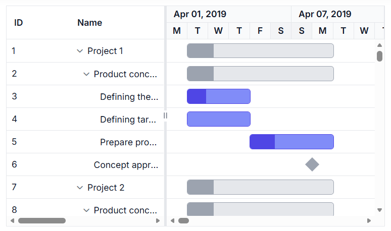
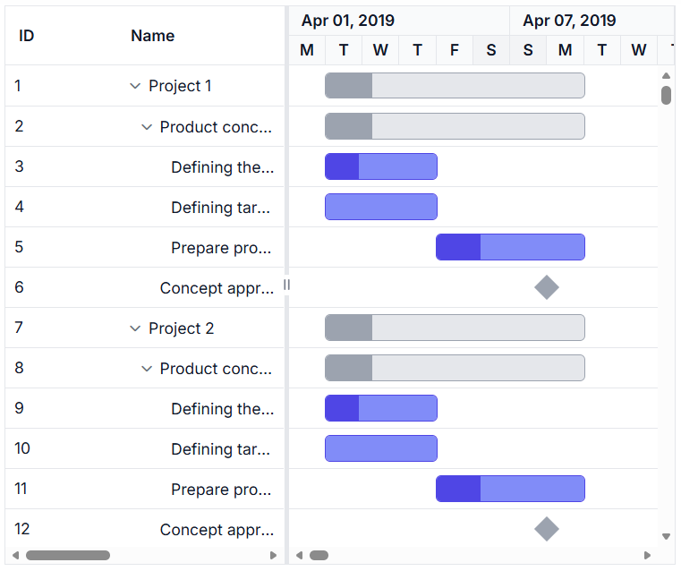
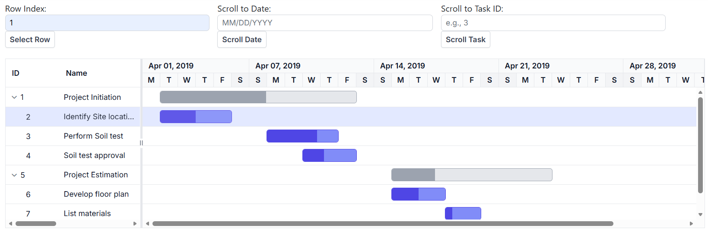
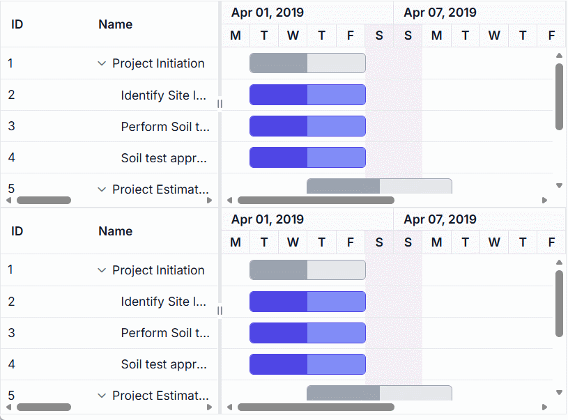

# Scrolling in Syncfusion ASP.NET Core Gantt Chart

Scrolling in the [ASP.NET Core Gantt Chart](https://www.syncfusion.com/aspnet-core-ui-controls/gantt-chart) component enables smooth navigation across extensive project datasets and long timelines. It ensures taskbars, grid rows, and timeline cells remain visible within the viewport. Scrollbars automatically appear when content exceeds the component’s defined [height](https://help.syncfusion.com/cr/aspnetcore-js2/Syncfusion.EJ2.Gantt.Gantt.html#Syncfusion_EJ2_Gantt_Gantt_Height) and [width](https://help.syncfusion.com/cr/aspnetcore-js2/Syncfusion.EJ2.Gantt.Gantt.html#Syncfusion_EJ2_Gantt_Gantt_Width), supporting vertical scrolling for rows, horizontal scrolling for columns, and timeline scrolling for extended chart areas.

Virtual scrolling enhances performance by rendering only the visible portion of the dataset. Scrollbars are equipped with ARIA labels for accessibility, making them compatible with screen readers. They also adapt to responsive layouts, although horizontal scrolling may be required on narrow screens with wide timelines.

> By default, both `height` and `width` are set to **auto**.

## Configure scrollbar display

Scrollbars appear based on content size:

- **Vertical scrollbar:** Triggers when task row height exceeds the component’s height.
- **Horizontal scrollbar:** Triggers when column width exceeds the tree grid pane.
- **Timeline scrollbar:** Triggers when the timeline exceeds the chart area.

For precise layout control, set fixed dimensions using pixel values for both [width](https://help.syncfusion.com/cr/aspnetcore-js2/Syncfusion.EJ2.Gantt.Gantt.html#Syncfusion_EJ2_Gantt_Gantt_Width) and [height](https://help.syncfusion.com/cr/aspnetcore-js2/Syncfusion.EJ2.Gantt.Gantt.html#Syncfusion_EJ2_Gantt_Gantt_Height).










## Configure responsive scrolling

You can make the Gantt Chart component responsive by setting its [width](https://help.syncfusion.com/cr/aspnetcore-js2/Syncfusion.EJ2.Gantt.Gantt.html#Syncfusion_EJ2_Gantt_Gantt_Width) and [height](https://help.syncfusion.com/cr/aspnetcore-js2/Syncfusion.EJ2.Gantt.Gantt.html#Syncfusion_EJ2_Gantt_Gantt_Height) to **100%**, allowing it to fully occupy the parent container. When height is set to **100%**, the parent element must have a defined `height` to support proper layout rendering. The Gantt will automatically adjust when the container is resized.










## Scroll to task row and timeline

The ASP.NET Core Gantt Chart component provides built-in support for automatically scrolling to specific tasks and timeline positions, which is especially useful when working with large datasets.

To scroll vertically to a specific task row, use the `selectRow` method to select the desired task and apply `setScrollTop` to bring the selected row into view.

To scroll horizontally to a specific timeline date, use the `scrollToDate` method. This helps focus the timeline on a particular point in time.

To scroll directly to a specific task within the timeline, use the `scrollToTask` method with the task ID. This ensures the task is visible within the timeline view.










## Synchronize horizontal scroll between Gantt charts

To synchronize horizontal scrolling across multiple Gantt Chart components, handle the [actionComplete](https://help.syncfusion.com/cr/aspnetcore-js2/Syncfusion.EJ2.Gantt.Gantt.html#Syncfusion_EJ2_Gantt_Gantt_ActionComplete) event with the **HorizontalScroll** action. This captures the scroll position of the first Gantt chart and applies it to the second Gantt using the `scrollLeft` property. This approach ensures aligned timeline navigation, which is especially useful for comparing related project data side-by-side, such as parallel schedules.










