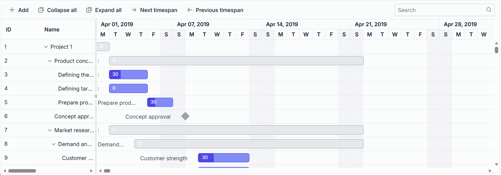

# Virtual Scrolling in ASP.NET Core Gantt Chart

Virtual scrolling in the [ASP.NET Core Gantt Chart](https://www.syncfusion.com/aspnet-core-ui-controls/gantt-chart) enhances performance by rendering only visible tasks and timeline segments, minimizing DOM operations for large datasets or extensive timelines. It includes row virtualization for handling thousands of tasks (e.g., 10,000 tasks in a project) and timeline virtualization for wide timelines (e.g., multi-year projects). Row virtualization renders tasks within the viewport, while timeline virtualization loads timeline cells on-demand during horizontal scrolling, ensuring efficient rendering for complex project management.

## Configure row virtualization

Row virtualization, enabled by setting [enableVirtualization](https://help.syncfusion.com/cr/aspnetcore-js2/Syncfusion.EJ2.Gantt.Gantt.html#Syncfusion_EJ2_Gantt_Gantt_EnableVirtualization) to **true**, only tasks visible in the Gantt’s viewport, determined by the `height` property in pixels (e.g., "600px"). All tasks are fetched initially but rendered on-demand during vertical scrolling, reducing load times for large datasets. For example, a project with 10,000 tasks renders only the 50 visible tasks, improving performance.

Set the Gantt `Height` in pixels to define the viewport and control how many records are displayed. The following example enables row virtualization:










## Configure timeline virtualization

Timeline virtualization, enabled by setting [enableTimelineVirtualization](https://help.syncfusion.com/cr/aspnetcore-js2/Syncfusion.EJ2.Gantt.Gantt.html#Syncfusion_EJ2_Gantt_Gantt_EnableTimelineVirtualization) to **true**, renders timeline cells for three times the Gantt width initially. Additional cells are rendered on demand during horizontal scrolling, which improves performance for wide timelines, such as multi-year projects. The following example enables timeline virtualization:










## Virtual scrolling limitations

Virtual scrolling has the following limitations:

* Immutable mode is not supported with virtualization.
* Cell selection is not persisted because rows and cells are rendered on demand.
* Browser element-height limits restrict the maximum number of records that can be loaded with row virtualization.
* Set the Gantt [height](https://help.syncfusion.com/cr/aspnetcore-js2/Syncfusion.EJ2.Gantt.Gantt.html#Syncfusion_EJ2_Gantt_Gantt_Height) in pixels to define the row virtualization viewport. If you set the height to **100%**, its parent container must also have an explicit height.
* When virtual scrolling loads records in pages, Gantt public methods operate on the records available in the current page rather than the entire data source.

## See also

* [Data binding in ASP.NET Core Gantt Chart](https://help.syncfusion.com/gantt-sdk/asp-net-core/gantt-chart/data-binding)
* [Scrolling in ASP.NET Core Gantt Chart](https://help.syncfusion.com/gantt-sdk/asp-net-core/gantt-chart/scrolling)
